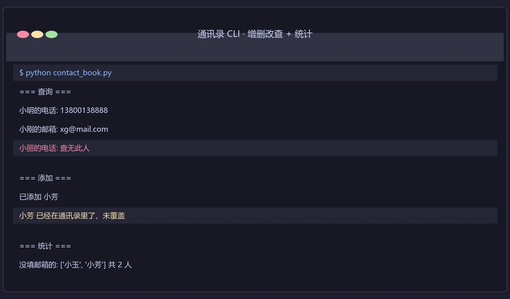
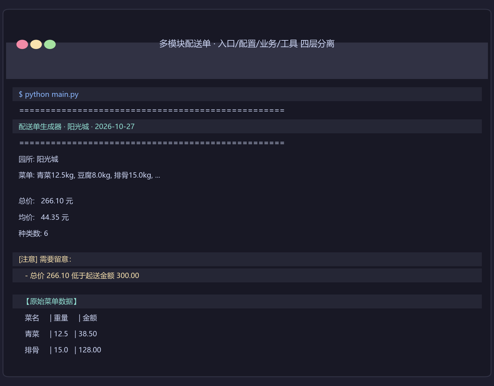
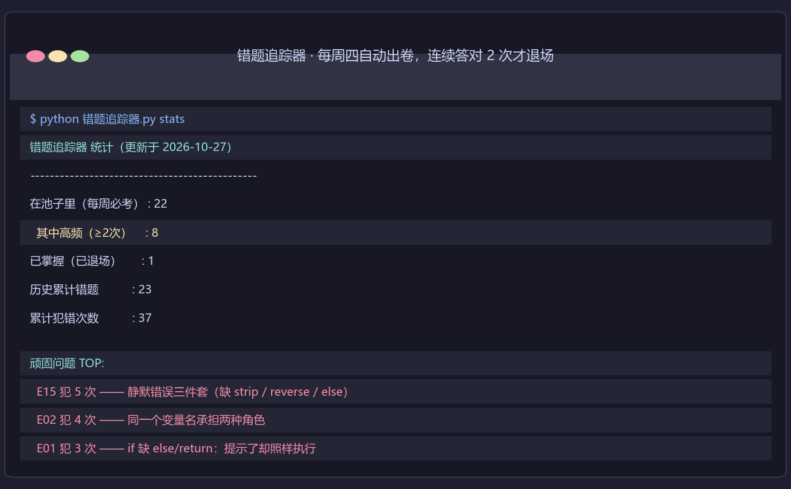

# Python 学习路径 · 从零到 AI 应用工程师

<div align="center">

**朱森源** · 民办本科大三 · 求职方向：AI 应用工程师

[](https://www.python.org/)
[](https://github.com/zhusenyuan-06/python-learning-path)
[](#成长轨迹)

</div>

---

## 我是谁

民办本科大三学生，**从 `print("hello")` 开始学 Python**，目标是把 AI 应用工程师的岗位拿下。

我不写"认真负责"这种空话。能证明的是：

- **6 个可运行项目** —— 不是片段，是能 `python xxx.py` 直接跑起来的
- **22 条错题追踪记录** —— 自己写的系统，每周四自动出卷，连对 2 次才算掌握
- **11 条工具链坑** —— git / 网络 / Windows 环境的坑，踩一次记一次
- **真实交付经验** —— 幼儿园食材汇总工具已打包交付园方使用

<div align="center">
  
  <br><sub>作品 · 通讯录 CLI（增删改查 + 统计未填邮箱 + 防覆盖校验）</sub>
</div>

---

## 作品速览

> 找工作的看这一节就够了。想看我怎么学的，往下滚到 [成长轨迹](#成长轨迹)。

| # | 项目 | 说明 | 技术点 |
|---|---|---|---|
| 1 | **多模块配送单生成器** ⭐ | 完整项目结构：入口 / 配置 / 业务 / 工具四层分离，CSV 读数据 → 算账 → 校验 → 出表格 | 模块拆分、跨文件 import、`__name__` 入口守卫、csv 读写、os.path 路径、f-string |
| 2 | **通讯录 CLI** ⭐ | 命令行版通讯录，增删改查 + 统计未填邮箱 + 双层遍历展示 | dict 套 dict、函数封装、安全查询 `.get()`、防覆盖 |
| 3 | **错题追踪器** | 管理自己的错题池。每周四自动出复习卷，连续答对 2 次才退场，再犯门槛 +1 | dict 嵌套、JSON 读写、CLI 参数、状态机 |
| 4 | **工具链坑追踪器** | 记录非 Python 的坑（git 配置 / 网络排障 / Windows 环境），踩一次计数 +1 自动排序 | JSON 读写、CLI 参数、Markdown 渲染 |
| 5 | **词频统计** | 读文本 → 清洗 → 计数 → 排序 → 取 TOP N | 文件读写、字典计数、排序、推导式 |
| 6 | **待办工具** | 命令行待办事项 | 函数拆分、数据持久化 |

<div align="center">
  
  <br><sub>作品 1 · 多模块配送单生成器（四层架构，改一个参数全局生效）</sub>
</div>

<div align="center">
  
  <br><sub>分层结构：依赖单向不循环 —— 改一个文件不会碰坏其它模块</sub>
</div>

### 怎么跑

```bash
# 作品 1：多模块配送单生成器
cd 小项目_多模块demo
python main.py

# 作品 2：通讯录 CLI
cd projects/contact-book
python contact_book.py

# 作品 3：错题追踪器
cd 笔记
python 错题追踪器.py stats        # 看池子里还剩几题
python 错题追踪器.py plan 6        # 生成本周复习卷

# 作品 4：工具链坑追踪器
cd 笔记
python 工具链坑.py ls
```

---

## 成长轨迹

> 这一节给面试官看 —— **我学了什么、怎么学的、踩过什么坑**。

### 学习方式

| 原则 | 具体做法 |
|---|---|
| **不复制粘贴** | 每个项目从空文件手写 |
| **写完必跑** | 不靠"看起来对"，靠输出说话 |
| **错题追踪** | 所有踩过的坑记进系统，每周四复习直到不再犯 |
| **静默错误优先** | 能跑但结果是错的错，比会报错的错更值得警惕 |

<div align="center">
  
  <br><sub>我给自己写的复习系统 —— 顽固问题自动排前面</sub>
</div>

### 学习路线（16 周 · 当前第 5 周）

| 周次 | 阶段 | 内容 | 状态 |
|---|---|---|---|
| 1-2 | 阶段 1 | 变量 / 类型 / 运算符 / 字符串 / 分支 / 循环 | ✅ |
| 3-4 | 阶段 1 | 函数 / 作用域 / 字典 / 列表 / 集合 / 推导式 | ✅ |
| 5 | 阶段 1 | 文件读写 / JSON / 异常 / **`*args` `**kwargs`** / **模块与导入** | 🔄 进行中 |
| 6-8 | 阶段 1 | csv / json / 异常 / 重命名 / 词频作品化 | ⬜ |
| 9-12 | 阶段 2 | requests / pandas / PDF 解析 / SQLite / API 调用 | ⬜ |
| 13-16 | 阶段 3 | RAG 原理 / LangChain 认知 / FastAPI / Claude Code 协作 | ⬜ |

> 16 周计划全部落在一张表里，**每天做什么、做到没有，逐格可查**。

### 我踩过的坑（精选）

完整的在 [`笔记/错题追踪.md`](笔记/错题追踪.md)（22 条，每周四抽考）。

#### 静默错误：代码能跑，但结果是错的

```python
# ❌ 缺 .strip() —— "python." 和 "python" 被当成两个词
w = w.lower()

# ✅
w = w.lower().strip(".,!?")
```

```python
# ❌ 缺 reverse=True —— 排出来的"前 N 名"其实是最后 N 名
after = sorted(counts.items(), key=lambda x: x[1])

# ✅
after = sorted(counts.items(), key=lambda x: x[1], reverse=True)
```

```python
# ❌ if 缺 return —— 提示了"未覆盖"，照样覆盖了
if 姓名 in contacts:
    print("已存在，未覆盖")
contacts[姓名] = {...}

# ✅ 有 return 就停在那
if 姓名 in contacts:
    return "已存在，未覆盖"
```

#### 变量角色混用（同一个病根犯了 4 次）

```python
# ❌ 入参被覆盖成累加器
def sum_list(nums): nums = 0

# ✅ 一个名字从头到尾只干一件事
def sum_list(nums):
    total = 0
    for i in nums:
        total += i
    return total
```

#### key= 传函数本身，不带括号

```python
sorted(d, key=pinjun)      # ✅
sorted(d, key=pinjun())    # ❌ TypeError
```

#### 中文变乱码：json.dumps 忘写 ensure_ascii=False

```python
# ❌ 中文变成 \u83dc\u540d
s = json.dumps(订单)

# ✅ 跟中文打交道，dumps 永远写死 ensure_ascii=False
s = json.dumps(订单, ensure_ascii=False)
```

---

## 目录结构

```
pythonProject/
├── projects/                    # ★ 作品集（HR 点开就看这里）
│   └── contact-book/            # 作品 2：通讯录 CLI
├── 小项目_多模块demo/           # 作品 1：四层架构示例
│   ├── main.py                  # 入口层：只组装
│   ├── config.py                # 配置层：常量 + 路径
│   ├── business.py              # 业务层：业务规则
│   ├── utils/helpers.py         # 工具层：与业务无关
│   └── data/菜单.csv            # 数据
├── 练习/                        # 我写的代码，按日期/主题命名
├── 教学/                        # 概念讲解 + 可运行示例
├── 参考材料/                    # 讲义 / 探针脚本 / 答案
├── 笔记/                        # 学习笔记 + 两个追踪器
│   ├── 错题追踪器.py / .json / .md
│   ├── 工具链坑.py / .json / .md
│   ├── 周复盘_*.md
│   └── 学习总结_*.md
├── 截图/                        # README 用图
└── push*.sh                     # git 推送辅助（本地，不上传）
```

> 目录约定：`练习/` 是我写的、`教学/` 是学的、`参考材料/` 是查阅的、`projects/` 是能拿出手的。

---

## 技术栈

- **Python 3.12** —— 基础语法、函数、容器、文件/JSON/CSV 读写、模块化设计
- **标准库** —— `dict` / `list` / `set` / `tuple`、`json`、`csv`、`os.path`、`datetime`
- **工程化** —— Git / GitHub（日常提交）、PyCharm、venv + PyInstaller 打包交付
- **进行中** —— requests、pandas、SQLite、FastAPI、RAG 检索增强

---

## 更新记录

| 日期 | 内容 |
|---|---|
| 2026-09-28 | 环境安装、第一个程序 |
| 2026-10-17 | 函数、作用域、`sum_list` 重构 |
| 2026-10-19 | dict 增删改查、嵌套 dict、双层遍历 |
| 2026-10-20 | set 运算、三大容器方法、选型三问 |
| 2026-10-21 | 词频统计、通讯录（dict of dict） |
| 2026-10-22 | 大复习 + 错题追踪系统 + 合并排序练习 |
| 2026-10-27 | 通讯录作品化 + JD 能力缺口登记 + `*args`/`**kwargs` + 模块与导入 + 目录重组 |
| 2026-10-28 | README 改造成作品集主页（A+B 合一）+ 终端截图生成 |

---

## 联系

持续更新中 · 欢迎交流技术

[GitHub](https://github.com/zhusenyuan-06/python-learning-path) · 邮箱见 GitHub 主页
