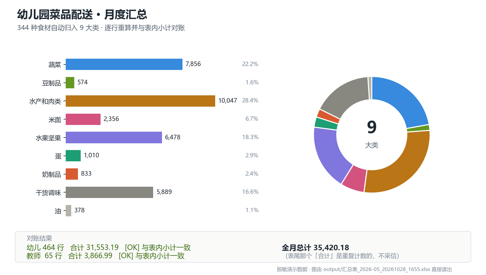
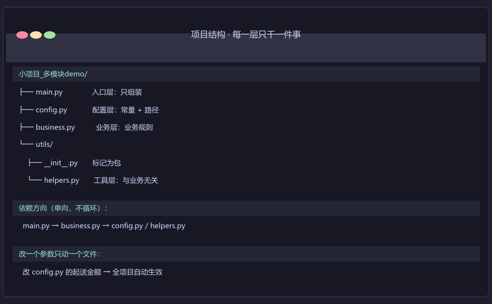

# Python 学习路径 · 从零到 AI 应用工程师

<div align="center">

**朱森源** · 民办本科大三 · 求职方向：AI 应用工程师

[](https://www.python.org/)
[](https://github.com/zhusenyuan-06/python-learning-path)
[](#成长轨迹)

</div>

---

## 我是谁

民办本科大三学生，**从 `print("hello")` 开始学 Python**，目标是把 AI 应用工程师的岗位拿下。

我不写"认真负责"这种空话。能证明的是：

- **9 个可运行项目** —— 不是片段，是能 `python xxx.py` 直接跑起来的
- **36 条错题追踪记录** —— 自己写的系统，每周四自动出卷，连对 2 次才算掌握
- **22 条工具链坑** —— git / 网络 / Windows 环境的坑，踩一次记一次
- **真实交付经验** —— 幼儿园菜品汇总工具已打包交付园方使用（**数据已脱敏**）

<div align="center">
  
  <br><sub>作品 1 · 幼儿园菜品配送汇总工具（已交付园方使用 —— 344 种食材自动归入 9 大类，逐行重算并对账）<br>图由交付的 output/汇总表 Excel 直接读出，不是手绘示意图</sub>
</div>

---

## 作品速览

> 找工作的看这一节就够了。想看我怎么学的，往下滚到 [成长轨迹](#成长轨迹)。

| # | 项目 | 说明 | 技术点 |
|---|---|---|---|
| 1 | **[幼儿园菜品配送汇总工具](projects/幼儿园菜汇总工具/README.md)** ⭐ | **已交付园方使用的真实项目**（数据已脱敏）。把每月送货单丢进去，自动按 9 大类汇总成带图表的 Excel：344 种食材自动归类、逐行重算金额并与表内小计对账、多供应商分表 + 全园合并 | pandas 数据清洗、openpyxl 读写、YAML 配置化规则、Excel 原生图表、公式缓存值处理、多种表格格式兼容、PyInstaller 打包 |
| 2 | **[多模块配送单生成器](小项目_多模块demo/README.md)** ⭐ | 完整项目结构：入口 / 配置 / 业务 / 工具四层分离，CSV 读数据 → 算账 → 校验 → 出表格。改一个参数全局生效 | 模块拆分、跨文件 import、`__name__` 入口守卫、csv 读写、os.path 路径、f-string |
| 3 | **[通讯录 CLI](projects/contact-book/README.md)** ⭐ | 命令行版通讯录，增删改查 + 统计未填邮箱 + 双层遍历展示 | dict 套 dict、函数封装、安全查询 `.get()`、防覆盖 |
| 4 | **[错题追踪器](projects/error-tracker/README.md)** | 管理自己的错题池。每周四自动出复习卷，连续答对 2 次才退场，再犯门槛 +1。已积累 36 题 / 70 次犯错 / 8 题已退场 | dict 嵌套、JSON 读写、CLI 参数、状态机、优先级排序 |
| 5 | **[工具链坑追踪器](笔记/工具链/工具链坑_README.md)** | 记录非 Python 的坑（git 配置 / 网络排障 / Windows 环境），踩一次计数 +1 自动排序。已积累 22 条 / 27 次踩坑 | JSON 读写、CLI 参数、Markdown 渲染、标签系统 |
| 6 | **[词频统计器 CLI](projects/词频统计器/README.md)** | 统计文本里每个词出现多少次，**中英文混排都能切**。结果可复现（次数相同时按词字典序排，跟词在文件里出现的顺序无关）、条形图可视化、文件不存在给中文提示而不是甩红字 | 正则切词（`[\u4e00-\u9fa5]+\|[a-zA-Z]+`）、dict 词频计数、`sorted` 元组 key 可复现排序、argparse 位置参数 + 可选参数、友好报错层 |
| 7 | **[待办工具 CLI](projects/todo-cli/README.md)** | 命令行版待办工具，add / list / done / del 四条命令，任务存本地 JSON，**程序关了再开任务还在**。保存走**原子写入**（先写临时文件再替换），中途崩溃也不丢数据 | JSON 读写、原子写入（临时文件 + `os.replace`）、CLI 循环、异常捕获、函数封装 |
| 8 | **[批量重命名文件脚本](projects/batch-rename/README.md)** | 把某目录下文件名里的「旧片段」批量换成「新片段」。**干跑默认开** —— 先打印计划表给你看，确认了才真改；改错了能按日志**一键撤销**。支持链式改名（两阶段） | 干跑（dry-run）默认开、冲突预检、操作日志 + 反向撤销、`argparse` 位置/可选参数、逐文件 try/except 隔离 |
| 9 | **[API 数据落地练习](projects/api-demo/README.md)** | 把数据从网上抓下来、解析成 Python 对象、再存成能反复用的本地文件。6 个脚本走通「请求 → 解析 → 存储」全链路，**每个坑都实跑复现过** | venv 虚拟环境隔离、requests GET、`json` 四对函数、嵌套取值与拍平、状态码优先的错误处理、CSV 落地三参数 |

> 九个项目**都有独立 README**（链接直达），里面是真实运行输出、技术点原因和踩坑复盘。

### 练习片段（不是项目，不计入上面的数量）

这三个是**学习时的练习文件**，不是能拿出手的项目 —— 所以我单独列出来，不混进项目数里：

| 文件 | 行数 | 是什么 |
|---|---|---|
| [`练习/词频统计器进阶版.py`](练习/词频统计器进阶版.py) | 32 行 | 教学骨架：读文件 → 切词 → 字典计数 → 排序取 TOP N。文件里带着「核心逻辑由你填」和参考答案 |
| [`练习/词频.py`](练习/词频.py) | 8 行 | 最小的词频演示，就是 `d.get(w, 0) + 1` 那一句 |
| [`练习/待办工具.py`](练习/待办工具.py) | 63 行 | 待办 CLI **教学骨架**：`add_task` / `list_tasks` / `mark_done` 三个函数已写好，主流程留给读者填 —— 是作品 7 的**前置练习**，不是同一个东西 |

> 它们记录的是**我学到哪一步了**，不是**我能交付什么**。

<div align="center">
  
  <br><sub>作品 2 · 多模块配送单生成器 —— 四层结构：依赖单向不循环，改一个文件不会碰坏其它模块</sub>
</div>

### 怎么跑

```bash
# 作品 1：幼儿园菜品配送汇总工具（数据已脱敏，原样可跑）
cd projects/幼儿园菜汇总工具
python src/run.py check      # 只读取 + 对账，不出汇总表
python src/run.py report     # 出正式汇总表到 output/

# 作品 2：多模块配送单生成器
cd 小项目_多模块demo
python main.py

# 作品 3：通讯录 CLI
cd projects/contact-book
python contact_book.py

# 作品 4：错题追踪器
cd projects/error-tracker
python 错题追踪器.py stats        # 看池子里还剩几题
python 错题追踪器.py plan 6        # 生成本周复习卷

# 作品 5：工具链坑追踪器
cd 笔记/工具链
python 工具链坑.py ls

# 作品 6：词频统计器 CLI
cd projects/词频统计器
python 词频统计器.py 数据.txt --top 10

# 作品 7：待办工具 CLI（交互式，输 quit 退出）
cd projects/todo-cli
python todo_cli.py

# 作品 8：批量重命名（不加 --apply 只打印计划，不改任何文件）
cd projects/batch-rename
python batch_rename.py D:/你的目录 _v1 _v2 --apply

# 作品 9：API 数据落地练习（★ 必须先建虚拟环境，见该目录 README）
cd projects/api-demo
D:\AAAA\python.exe -m venv .venv
.\.venv\Scripts\Activate.ps1
python -m pip install -r requirements.txt
python 06_存成CSV.py
```

---

## 成长轨迹

> 这一节给面试官看 —— **我学了什么、怎么学的、踩过什么坑**。

### 学习方式

| 原则 | 具体做法 |
|---|---|
| **不复制粘贴** | 每个项目从空文件手写 |
| **写完必跑** | 不靠"看起来对"，靠输出说话 |
| **错题追踪** | 所有踩过的坑记进系统，每周四复习直到不再犯 |
| **静默错误优先** | 能跑但结果是错的错，比会报错的错更值得警惕 |

### 学习路线（16 周 · 当前第 7 周）

| 周次 | 阶段 | 内容 | 状态 |
|---|---|---|---|
| 1-2 | 阶段 1 | 变量 / 类型 / 运算符 / 字符串 / 分支 / 循环 | ✅ |
| 3-4 | 阶段 1 | 函数 / 作用域 / 字典 / 列表 / 集合 / 推导式 | ✅ |
| 5 | 阶段 1 | 文件读写 / JSON / 异常 / **`*args` `**kwargs`** / **模块与导入** | ✅ |
| 6-8 | 阶段 1 | csv / json / 异常 / 批量重命名 / 词频作品化 | ✅ |
| 7（提前学） | 阶段 1 收尾 | **venv 虚拟环境 / requests / API 调用** | ✅ |
| 9-12 | 阶段 2 | pandas / PDF 解析 / SQLite / 数据清洗 | ⬜ |
| 13-16 | 阶段 3 | RAG 原理 / LangChain 认知 / FastAPI / Claude Code 协作 | ⬜ |

> 16 周计划全部落在一张表里，**每天做什么、做到没有，逐格可查**。

### 我踩过的坑（精选）

完整的在 [`projects/error-tracker/错题追踪.md`](projects/error-tracker/错题追踪.md)（36 题 / 累计犯错 70 次，每周四抽考）。

#### 静默错误：代码能跑，但结果是错的

```python
# ❌ 缺 .strip() —— "python." 和 "python" 被当成两个词
w = w.lower()

# ✅
w = w.lower().strip(".,!?")
```

```python
# ❌ 缺 reverse=True —— 排出来的"前 N 名"其实是最后 N 名
after = sorted(counts.items(), key=lambda x: x[1])

# ✅
after = sorted(counts.items(), key=lambda x: x[1], reverse=True)
```

```python
# ❌ if 缺 return —— 提示了"未覆盖"，照样覆盖了
if 姓名 in contacts:
    print("已存在，未覆盖")
contacts[姓名] = {...}

# ✅ 有 return 就停在那
if 姓名 in contacts:
    return "已存在，未覆盖"
```

#### 变量角色混用（同一个病根犯了 4 次）

```python
# ❌ 入参被覆盖成累加器
def sum_list(nums): nums = 0

# ✅ 一个名字从头到尾只干一件事
def sum_list(nums):
    total = 0
    for i in nums:
        total += i
    return total
```

#### key= 传函数本身，不带括号

```python
sorted(d, key=pinjun)      # ✅
sorted(d, key=pinjun())    # ❌ TypeError
```

#### 中文变乱码：json.dumps 忘写 ensure_ascii=False

```python
# ❌ 中文变成 \u83dc\u540d
s = json.dumps(订单)

# ✅ 跟中文打交道，dumps 永远写死 ensure_ascii=False
s = json.dumps(订单, ensure_ascii=False)
```

---

## 目录结构

```
pythonProject/
├── projects/                    # ★ 作品集（HR 点开就看这里）
│   ├── 幼儿园菜汇总工具/         # 作品 1：已交付园方的菜品配送汇总（数据已脱敏）
│   │   ├── src/                 # 7 个脚本：读取 / 归类 / 出表 / 造样本
│   │   ├── config/              # categories.yaml（9 大类规则）+ mapping.xlsx（344 种食材）
│   │   ├── input/               # 脱敏后的原始送货单
│   │   ├── output/              # 生成的汇总表
│   │   └── data/月度台账.csv      # 趋势图数据源
│   ├── contact-book/            # 作品 3：通讯录 CLI
│   ├── 词频统计器/              # 作品 6：词频统计 CLI（中英文混排 + 可复现排序）
│   ├── todo-cli/                # 作品 7：待办 CLI（增删改查 + JSON 持久化 + 原子写入）
│   ├── batch-rename/            # 作品 8：批量重命名（干跑默认开 + 冲突预检 + 一键撤销）
│   ├── api-demo/                # 作品 9：API 数据落地（venv + requests + JSON + CSV）
│   │   ├── 01_第一次GET.py       # 请求 → 看状态码 / 响应头 / 正文切片
│   │   ├── 02_第一次GET_httpbin.py # 回声壁：看清请求与响应的结构
│   │   ├── 03_解析JSON.py        # text vs json()，故意撞一次 404
│   │   ├── 04_正确的错误处理.py    # 先判状态码 / raise_for_status 两种写法
│   │   ├── 05_存成JSON.py        # 嵌套取值 → 存 JSON → 读回核对
│   │   ├── 06_存成CSV.py         # 拍平成表格 → 存 CSV → 读回核对
│   │   ├── requirements.txt      # 依赖清单
│   │   └── 输出/                  # 运行时数据（已 gitignore）
│   └── error-tracker/           # 作品 4：错题追踪器
│       ├── 错题追踪器.py         # 主程序：出卷 / 判分 / 退场
│       ├── 错题追踪.json         # 错题池数据（36 题 / 70 次犯错 / 8 题已退场）
│       ├── 错题追踪.md           # 自动渲染出来的错题清单
│       └── README.md            # 作品说明
├── 小项目_多模块demo/           # 作品 2：四层架构示例
│   ├── README.md                # 作品说明：结构图 + 真实输出 + 踩坑
│   ├── main.py                  # 入口层：只组装
│   ├── config.py                # 配置层：常量 + 路径
│   ├── business.py              # 业务层：业务规则
│   ├── utils/helpers.py         # 工具层：与业务无关
│   └── data/菜单.csv            # 数据
├── 练习/                        # 我写的代码，按日期/主题命名
├── 教学/                        # 概念讲解 + 可运行示例
├── 参考材料/                    # 讲义 / 探针脚本 / 答案
├── 笔记/                        # 学习笔记（按用途分层，不再平铺）
│   ├── 复习卷/                   # 每周四的复习卷 + 对应的答案与讲解
│   ├── 讲义/                     # 专项讲解 + 答案与讲解 + 巩固清单
│   ├── 周复盘/                   # 每周复盘 + 复盘模板
│   ├── 求职/                     # JD 能力缺口登记 / 能力缺口清单 / 资产盘点
│   ├── 工具链/                   # 作品 5：工具链坑追踪器（.py / .json / .md / README）
│   └── _自检脚本/                # 一次性自检与批量维护脚本
├── 工具/                        # 本地辅助脚本（推送 / hosts 修复 / 一键开复习卷，不上传）
├── 截图/                        # README 用图
└── README.md                    # 就是这个文件
```

> 目录约定：`练习/` 是我写的、`教学/` 是学的、`参考材料/` 是查阅的、`projects/` 是能拿出手的。
> `笔记/` 里面按**用途**分层（复习卷 / 讲义 / 周复盘 / 求职 / 工具链），不按日期平铺 ——
> 因为真正会回头找的，是「复习卷」和「讲义」，不是「第 40 个 md」。

---

## 技术栈

- **Python 3.12** —— 基础语法、函数、容器、文件/JSON/CSV 读写、模块化设计
- **标准库** —— `dict` / `list` / `set` / `tuple`、`json`、`csv`、`os.path`、`datetime`
- **第三方库** —— `requests`（HTTP 请求）—— **已学完**：venv 隔离 / GET / JSON 解析 / 错误处理 / 存文件
- **工程化** —— Git / GitHub（日常提交）、PyCharm、venv + PyInstaller 打包交付
- **进行中** —— pandas、SQLite、FastAPI、RAG 检索增强

---

## 更新记录

| 日期 | 内容 |
|---|---|
| 2026-09-28 | 环境安装、第一个程序 |
| 2026-10-17 | 函数、作用域、`sum_list` 重构 |
| 2026-10-19 | dict 增删改查、嵌套 dict、双层遍历 |
| 2026-10-20 | set 运算、三大容器方法、选型三问 |
| 2026-10-21 | 词频统计、通讯录（dict of dict） |
| 2026-10-22 | 大复习 + 错题追踪系统 + 合并排序练习 |
| 2026-10-27 | 通讯录作品化 + JD 能力缺口登记 + `*args`/`**kwargs` + 模块与导入 + 目录重组 |
| 2026-10-28 | README 改造成作品集主页（A+B 合一）+ 终端截图生成 |
| 2026-10-28 | **作品 1「幼儿园菜品配送汇总工具」脱敏后并入仓库**（344 种食材→9 大类、逐行重算与对账、多供应商分表 + 全园合并、Excel 原生图表） |
| 2026-10-28 | **补齐作品 2 / 4 / 5 的独立 README**（真实运行输出 + 技术点原因 + 踩坑复盘）｜作品速览改为「5 个可运行项目」，词频统计 / 待办工具诚实降级为「练习片段」 |
| 2026-10-28 | **清理仿真终端截图**：删掉 3 张「模拟终端」图及其生成脚本（图与 README 文字对不上，且 macOS 窗口框与 Windows 环境矛盾），改为真实架构图 + 由交付 Excel 直接读出的图表 |
| 2026-11-10 | **作品 6「词频统计器」从练习片段升级为正式作品**（argparse 命令行 + 正则切中文 + 元组 key 可复现排序 + 友好报错层 + 条形图；README 记录 4 个实跑复现的坑）｜作品 5「批量重命名脚本」支持链式改名（两阶段）｜错题池 34→36、工具链坑补齐 T19/T20/T21/T22 正文｜根 README 作品速览数据同步到实际值（错题池 36 题 / 70 次犯错，工具链坑 22 条 / 27 次） |
| 2026-11-11 | **作品 7/8/9 补进作品速览表**（此前只有 6 行，todo-cli / 批量重命名 / API 数据落地 三个项目漏在表外）｜**作品 9「API 数据落地练习」成立**：venv + requests + JSON + CSV，6 个脚本，README 记录 8 个实跑复现的坑（含 CSV 三坑正反双向实验、`newline` 2×2 组合矩阵）｜README 过期数字同步到实际值（可运行项目 5→9、错题 22→36 条、进度 第 5 周→第 7 周、技术栈 requests 从「进行中」改为「已学完」） |

---

## 联系

持续更新中 · 欢迎交流技术

[GitHub](https://github.com/zhusenyuan-06/python-learning-path) · 邮箱见 GitHub 主页
