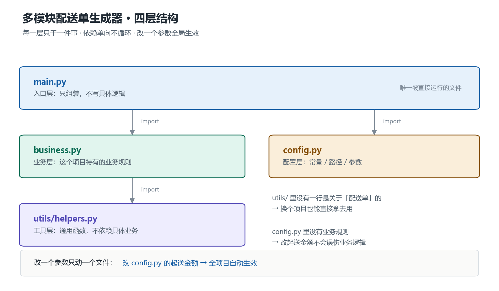

# 多模块配送单生成器

四层分离的完整项目结构：入口 / 配置 / 业务 / 工具。

写于 **2026-10-27 晚**，就在学完「模块与导入」那一节的当晚（commit `3822d4f`）。四个文件是一次性拆开的，不是后来重构的。

---

## 它长什么样

```
小项目_多模块demo/
├── main.py              入口层：只做组装，不写具体逻辑
├── config.py            配置层：常量 / 路径 / 参数，不放任何逻辑
├── business.py          业务层：这个项目特有的业务规则
├── utils/
│   ├── __init__.py
│   └── helpers.py       工具层：通用函数，不依赖具体业务
└── data/
    └── 菜单.csv         6 种菜：菜名 / 重量 / 金额
```

依赖是**单向**的，没有环：



```
main.py  ──import──▶  config.py
   │                      ▲
   │                      │ import
   ├──import──▶  business.py
   │                    │
   │                    └──import──▶  utils/helpers.py
   └──from utils import helpers
```

`helpers.py` 里没有一行是关于"配送单"的 → 换成别的项目也能直接拿去用。

---

## 功能

- [x] 读 CSV 菜单数据（`utf-8-sig`，兼容 Excel 另存的 BOM）
- [x] 算账：总价 / 均价 / 最高 / 最低 / 种类数
- [x] 拼菜单描述串：`青菜12.5kg, 豆腐8.0kg, ...`
- [x] 业务校验：总价低于起送金额 → 警告；种类数 < 2 → 建议
- [x] 打印对齐表格（`str.ljust` 按最大列宽对齐）
- [x] 改 `config.py` 一个参数，全局生效

---

## 快速开始

```bash
cd 小项目_多模块demo
python main.py
```

**实际运行输出**（这段是真实跑出来的，不是手编的）：

```text
==============================================================
配送单生成器 · 阳光城 · 2026-10-27
==============================================================
园所: 阳光城
日期: 2026-10-27
菜单: 青菜12.5kg, 豆腐8.0kg, 排骨15.0kg, 西红柿6.0kg, 土豆20.0kg, 冬瓜10.0kg

总价:   266.10 元
均价:   44.35 元
最高:   128.00 元
最低:   16.00 元
种类数: 6

⚠️ 需要注意：
   - 总价 266.10 低于起送金额 300.00

  【原始菜单数据】
   菜名     | 重量     | 金额
   青菜     | 12.5   | 38.50
   豆腐     | 8.0    | 16.00
   排骨     | 15.0   | 128.00
   西红柿   | 6.0    | 21.60
   土豆     | 20.0   | 44.00
   冬瓜     | 10.0   | 18.00
```

---

## 技术点

- **`__name__ == "__main__"` 入口守卫**：`main.py` 结尾那一行保证这个文件被 `import` 时不会自动跑一遍
  - **不这么写会怎样**：别的文件 `import main` 一下，配送单当场打印出来 —— 别人只想拿你的函数，却触发了整个流程
- **两种 import 写法**：`import config`（整个模块）vs `from utils import helpers`（从包里取一个模块）
  - 区别不只是写法：`import config` 之后要写 `config.园所名称`；`from utils import helpers` 之后直接写 `helpers.格式化金额`
- **`os.path.join` 拼路径**，不用 `+` 拼字符串
  - **不这么写会怎样**：`"D:/项目" + "/data"` 在 Windows 上能跑，换到别的系统就断了。`os.path.join` 会按当前系统的分隔符拼
- **`utf-8-sig` 读 CSV**：`utf-8-sig` 会自动吃掉 Excel 另存时带的头部 BOM
  - **真实影响**（我实测过）：用 `utf-8` 读，表头变成 `['\ufeff菜名', '重量', '金额']` —— 只有**第一列**多一个看不见的 `\ufeff`
  - **这次为什么没出事**：`金额` 是第 3 列，`表头.index("金额")` 照样返回 `2`；数据行也不带 BOM（`行[0]` 是干净的 `'青菜'`）。**换成 `utf-8`，这份代码一样跑得通**
  - **什么时候会炸**：哪天你写了 `表头[0]`，或者拿表头当字典 key 去查 `行["菜名"]` —— 这时候多出来的 `\ufeff` 就让查找永远返回 `None`
  - 所以 `utf-8-sig` 是**预防**，不是补救。它防的是一个**还没发生的错**
- **f-string 格式化**：`f"{数字:,.2f}"` 一行搞定千分位 + 两位小数
- **配置外置**：园所名、日期、起送金额全在 `config.py`，业务代码一行都不写死

### 改一个参数，全局生效

`config.py` 里有这么一段：

```python
# ⬇️⬇️ 2026-10-27 20:08 改动演示：只改这一个文件，看全局变化 ⬇️⬇️
园所名称 = "阳光城"          # 演示用名，已改
配送日期 = "2026-10-27"
最低起送金额 = 300.0          # 原：100.0
```

把 `最低起送金额` 从 `100.0` 改成 `300.0`，重跑 `python main.py`，输出立刻从"✅ 校验通过"变成：

```text
⚠️ 需要注意：
   - 总价 266.10 低于起送金额 300.00
```

**校验逻辑写在 `business.py`，阈值写在 `config.py`** —— 改阈值不用碰业务代码，改业务代码不会误伤阈值。这就是拆开的意思。

---

## 我踩过的坑

### 坑 1：路径多退了一级

`config.py` 一开始算项目根目录的时候，多剥了一层父目录，结果 `样例数据文件` 指向了一个不存在的位置。

**错在哪**：`config.py` 本身就在项目根目录，所以 `os.path.dirname(os.path.abspath(__file__))` **已经是**项目根了，再往上剥一层就退到 `pythonProject/` 去了。

**现在我的习惯**：用 `__file__` 算路径时，先问一句"这个文件自己住在哪一层"，别凭感觉多剥一次。

### 坑 2：CSV 表头带 BOM —— 一个**还没炸**的雷

见上面「`utf-8-sig` 读 CSV」那条。

**这一条比坑 1 更值得记**，因为它的危险恰恰在于「现在没出事」：

- 症状（潜在）：`表头` 变成 `['\ufeff菜名', ...]`，`\ufeff` 在编辑器里**完全看不见**
- 后果：哪天写了 `表头[0]` 或 `行["菜名"]`，查找永远返回 `None`，而你盯着代码看不出哪里不对
- 现状：**这份代码用 `utf-8` 也能跑通** —— 因为它取的是 `行[0]`（数据行，不带 BOM），列名 `金额` 又恰好在第 3 列

**这就是我记的"静默错误"那一类**：不是"跑不了"，而是"现在能跑、以后某个改动会让它坏掉、而坏的时候你看不出原因"。

> 所以我把它写进 README —— 不是为了证明我踩过（我没踩到），是为了让三个月后的自己知道**这里为什么用 `utf-8-sig` 而不是 `utf-8`**。

---

## 拆完之后，感觉更复杂了

> 拆完之后感觉更加的复杂了

这是做完之后的真实感觉，不是"回头看很值"那种漂亮话。

刚拆完那会儿确实更绕：以前一个文件从上往下读就懂，现在得先想清楚"这个函数在哪个文件里"、"这个常量在哪一层"。

但复杂度没有凭空消失，它只是**从"读代码"挪到了"查目录"**：

| 我要改什么 | 不拆的时候 | 拆了以后 |
|---|---|---|
| 改一个参数（起送金额） | 翻 1 个文件，但怕漏改 | 翻 1 个文件（`config.py`），**确定**不用再翻另外 3 个 |
| 换个项目要用"格式化金额" | 整个文件复制粘贴过去 | `from utils import helpers` 一行 |
| 想知道这函数在哪 | 就在眼前 | 查一下目录树 |

> 上面这段展开是我（AI）补的，帮你把这件事说完整 —— **你的原话就上面那一句**。要改成你自己的版本，直接改这段。

---

## 更新记录

| 日期 | 内容 |
|---|---|
| 2026-10-27 | 首次提交：四层结构一次拆开（commit `3822d4f`） |
| 2026-10-27 | 亲手改 `config.py` 验证"改一个参数全局生效" |
| 2026-10-28 | 补 README：真实运行输出、四层结构图、两个踩坑记录 |
| 2026-10-28 | 删掉仿真终端截图（内容与本文文字对不上），改用真实四层架构图 |
